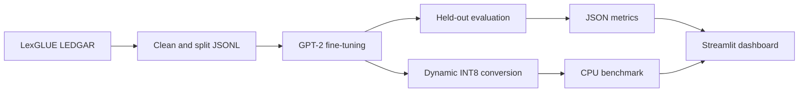

# Quantized Legal Tagger Monitor

An end-to-end local experiment that prepares LEDGAR legal clauses, fine-tunes GPT-2 to generate category labels, evaluates held-out performance, applies supported CPU dynamic quantization, and records measured model size and inference latency.

## Workflow



## Setup

Python 3.12 is recommended. On macOS Apple Silicon, PyTorch can use MPS for training when available; benchmarking and dynamic quantization run on CPU. On Linux, CUDA is selected automatically when available.

```bash
python3.12 -m venv .venv
source .venv/bin/activate
python -m pip install --upgrade pip
pip install -r requirements.txt
python -m app.cli health
```

## Run the project

Prepare the public `lex_glue/ledgar` dataset (downloads on first run, then caches local JSONL and a manifest):

```bash
python -m app.cli prepare --limit 5000
```

Fine-tune the pretrained `openai-community/gpt2` checkpoint:

```bash
python -m app.cli train --epochs 1 --batch-size 2 --max-length 256 --device auto
```

Use `--limit 200` to make a short development run. Training saves the final model under `artifacts/original` and periodic resumable checkpoints under `artifacts/checkpoint`. A model download is required on first training run.

```bash
python -m app.cli evaluate --split test
python -m app.cli quantize
python -m app.cli static-quantize
python -m app.cli benchmark --limit 50 --repeats 3
python -m app.cli dashboard
```

`static-quantize` records a reasoned unsupported status: GPT-2 uses custom `Conv1D` transformer projections and this implementation does not provide an executable full-model static INT8 generation path for those layers. Dynamic INT8 converts compatible `Linear` modules only; its JSON metadata records the coverage and leaves custom projections in FP32. Quantization results are real converted model artifacts, not simulated estimates.

For an unattended small-data pipeline run:

```bash
python -m app.cli pipeline --limit 200 --epochs 1 --device auto
```

## Artifacts and results

Generated data and models are intentionally excluded from Git. The dataset manifest and JSONL splits are in `data/ledgar/`. Model files and metric JSON live in `artifacts/`. The dashboard reads those files and shows a clear empty state before results exist. It never substitutes example metrics for missing results.

Recorded metrics include accuracy, weighted and macro F1, precision, recall, confusion matrix, parameter count, disk size, mean/median/P95 latency, throughput, and compression ratio where each is available. Timings are wall-clock CPU measurements for batch size one using the same held-out examples. Latency depends on hardware, runtime, model cache state, and generation length.

## CLI

Run `python -m app.cli --help` for all commands. `health`, `prepare`, `train`, `evaluate`, `quantize`, `static-quantize`, `benchmark`, `dashboard`, and `pipeline` cover the workflow. Dataset and artifact locations can be changed with `LEGAL_TAGGER_DATA_DIR` and `LEGAL_TAGGER_MODEL_DIR`.

## Tests

```bash
pytest -q
```

Unit tests use small synthetic inputs and do not download LEDGAR or GPT-2.

## Limitations

- Full LEDGAR has many highly imbalanced labels. A subset is useful for local development but is not a publication-quality evaluation.
- GPT-2 causal generation is not a purpose-built classifier and generated labels can be invalid; these are counted as `<unknown>` and reduce accuracy.
- MPS is used only for training/inference when available. Dynamic quantization is CPU-only.
- Dynamic conversion only affects supported `nn.Linear` layers. GPT-2's custom transformer `Conv1D` modules are not quantized by this path, so size and speed changes must be measured and may be modest or negative.
- Static quantization is marked unsupported rather than simulated.
- Results are only valid after the commands have actually run on the target machine; no sample metrics are presented as measured output.

## Security

No API key is required for the dataset or model workflow. `.env` is ignored by Git and is used only by the optional starter LLM helper. Never commit credentials, downloaded datasets, checkpoints, or generated artifacts.
