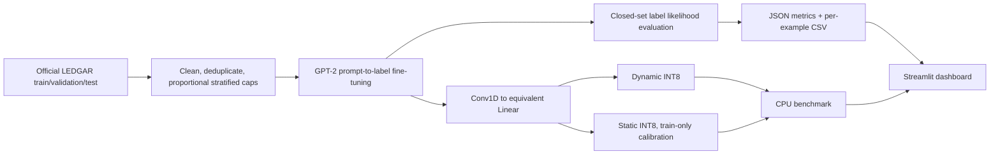

# Quantized Legal Tagger Monitor

An end-to-end ML engineering project for legal clause classification on CPU. It prepares LEDGAR's official splits, fine-tunes GPT-2 to generate category labels, scores the closed set of labels by conditional token likelihood, and compares FP32 with dynamic and static QNNPACK INT8 projection models.

## Architecture



The dataset is [LexGLUE LEDGAR](https://huggingface.co/datasets/coastalcph/lex_glue), a 100-class contract-provision classification dataset. GPT-2's `Conv1D` is a linear projection with transposed weight storage; Phase 2 verifies a transpose conversion against the original model before quantizing it ([Transformers implementation](https://github.com/huggingface/transformers/blob/main/src/transformers/pytorch_utils.py)). PyTorch's dynamic API supports weights-only quantization for selected modules ([PyTorch documentation](https://docs.pytorch.org/docs/stable/generated/torch.ao.quantization.quantize_dynamic.html)).

## Setup

Python 3.12 is recommended. This run used macOS 27.2 on arm64 with PyTorch 2.15.0 and CPU execution. MPS was unavailable to this installed runtime.

```bash
python3.12 -m venv .venv
source .venv/bin/activate
python -m pip install --upgrade pip
pip install -r requirements.txt
python -m app.cli health
```

## Reproduce the Phase 2 run

Set separate output directories to keep the Phase 1 experiment and its original reports intact:

```bash
export LEGAL_TAGGER_DATA_DIR=data/phase2
export LEGAL_TAGGER_MODEL_DIR=artifacts/phase2

python -m app.cli prepare --limit 3000
python -m app.cli train --limit 3000 --epochs 2 --batch-size 4 --max-length 160 --device cpu
python -m app.cli evaluate --split test
python -m app.cli quantize
python -m app.cli evaluate --model-path artifacts/phase2/dynamic --split test
python -m app.cli static-quantize --calibration-limit 128
python -m app.cli evaluate --model-path artifacts/phase2/static --split test
python -m app.cli benchmark --limit 50 --warmup 20 --iterations 100 --sessions 3
python -m app.cli dashboard
```

The dataset command caps the total at 3,000 and keeps the source splits separate: 2,400 train, 300 validation, and 300 test examples. Sampling is proportional to each official split's class distribution with a fixed seed (42); exact duplicate clause text is removed in source order. Training uses inverse-square-root class-frequency sampling. Test examples are not used for training, validation, checkpoint selection, or static calibration.

`train` saves resumable model, optimizer, cursor, and RNG checkpoints every 100 optimizer steps and at each epoch boundary. It returns the already completed model when the stored configuration matches. Use `--no-resume` to explicitly start over. `pipeline` runs all eight stages in order; its training stage reuses a completed matching run.

## Classification and evaluation

Greedy free-form generation was unreliable in the small Phase 1 run. Phase 2 keeps raw greedy output for diagnostics, but predicts by comparing the mean conditional log probability of each documented label token sequence. This is a deterministic, closed-set classification rule: it always returns a valid LEDGAR class, without turning raw invalid generations into correct predictions. The CSV records both the raw generation and parsed raw label next to the actual scored prediction.

Evaluation writes:

- `evaluation_{model}_test.json`: accuracy, macro and weighted precision/recall/F1, per-class scores, class distributions, confusion matrix, evaluation time, valid/invalid counts, and raw parse failures.
- `predictions_{model}_test.csv`: clause, truth, raw generation, parsed raw label, parse status, scored prediction, correctness, and error reason.

## Phase 2 measured results

### Experiment

- Dataset cap: 3,000 examples, 100 LEDGAR classes.
- Splits: 2,400 train / 300 validation / 300 test, from the official source splits.
- Fine-tuning: pretrained `openai-community/gpt2`, 2 epochs, batch size 4, max length 160, learning rate 5e-5, seed 42, CPU; 1,200 optimizer steps.
- Mean training loss by epoch: 0.8012, 0.3418. Final validation loss: 0.3381.
- Dynamic quantization converted 48 transformer projection layers. Static quantization calibrated 128 train examples and converted the same 48 projections.

### Held-out test results (300 examples)

| Model | Accuracy | Macro F1 | Weighted F1 | Valid predictions | Raw parse failures |
|---|---:|---:|---:|---:|---:|
| GPT-2 FP32 | 69.33% | 0.5496 | 0.6773 | 300 | 3 |
| Dynamic INT8 | 67.67% | 0.5360 | 0.6643 | 300 | 5 |
| Static INT8 | 68.67% | 0.5362 | 0.6711 | 300 | 4 |

Metrics are calculated on closed-set scored labels; raw parse failures are a separate diagnostic and do not replace those predictions.

### CPU efficiency benchmark

This benchmark used 50 distinct held-out test inputs, batch size one, 20 warmups, three sessions of 100 timed predictions each, and CPU for every model.

| Model | Size | Reduction | Mean | Median | P95 | Throughput | Accuracy on benchmark inputs | Speedup |
|---|---:|---:|---:|---:|---:|---:|---:|---:|
| GPT-2 FP32 | 479.31 MiB | — | 406.63 ms | 412.96 ms | 468.99 ms | 2.459/s | 70.0% | 1.000× |
| Dynamic INT8 | 236.35 MiB | 50.68% | 395.20 ms | 399.10 ms | 458.76 ms | 2.530/s | 70.0% | 1.029× |
| Static INT8 | 236.39 MiB | 50.67% | 407.10 ms | 408.68 ms | 471.66 ms | 2.456/s | 66.0% | 0.999× |

Dynamic INT8 was about 2.9% faster in this run; static INT8 was effectively equal to FP32 latency and slightly slower by the measured mean. The benchmark's macro-F1 is based on the 50 selected examples repeated over timed calls; use the 300-example evaluation JSON for headline quality metrics. Per-model RSS was not sampled, so memory is reported as unavailable. Hardware metadata records macOS arm64, 18 logical CPUs, Python, PyTorch, and CPU execution; the exact Apple SoC name was unavailable to the sandbox.

## Quantization details and limitations

- GPT-2 has 48 `Conv1D` projection modules in its 12 transformer blocks. Each was converted to `nn.Linear` with transposed weights; FP32 logits matched exactly in the verification probe (maximum absolute difference 0.0).
- Dynamic INT8 quantizes the 48 projection layers. The embedding matrix and tied output head remain FP32; avoiding quantization of the tied head also avoids storing a duplicate copy of its large weight.
- Static INT8 uses QNNPACK `QuantWrapper` activation observers around those 48 projections. Calibration used only the training split (128 examples). Embeddings, layer norms, attention operations, KV cache, and tied output head remain FP32. Both compressed models were saved, reloaded, and passed actual inference.
- Static and dynamic INT8 produced large full-vocabulary logit deviations on the verification probe (dynamic mean/max absolute error 11.32/118.93; static 14.03/145.66). Held-out accuracy and F1 degraded only slightly in this run, but results should be treated as an experiment, not a production quality guarantee.
- PyTorch emits deprecation warnings for the eager `torch.ao.quantization` API and a QNNPACK `reduce_range` warning. The current runtime executed both paths; future PyTorch releases may require migration to TorchAO.
- The 300-example subset is more useful than the Phase 1 smoke run, but remains small relative to the complete corpus and does not establish production performance.

## Phase 1 results preserved

The original development experiment remains under the root `artifacts/` and `data/ledgar/` paths. It used 300 prepared examples, 40 train examples, and a five-row matched benchmark. The baseline and old one-layer dynamic conversion both scored 0% on that matched benchmark. The old dynamic artifact was 516.35 MiB versus 479.31 MiB FP32 and was slightly slower. Phase 2 uses separate directories and does not overwrite those JSON reports.

## Dashboard and artifacts

```bash
python -m app.cli dashboard
```

The dashboard discovers saved experiment runs, compares size, latency, accuracy and F1, displays hardware and benchmark configuration, explores per-class scores and confusion matrices, shows raw prediction diagnostics and quantization details, and offers JSON/CSV downloads. It reads recorded results only and has an empty state when no report exists.

Useful files under `artifacts/phase2/`:

- `training.json`
- `evaluation_{original,dynamic,static}_test.json`
- `predictions_{original,dynamic,static}_test.csv`
- `quantization_dynamic.json`, `quantization_static.json`
- `benchmark.json`, `benchmark.csv`
- `original/`, `dynamic/`, and `static/` model folders

Generated data and models are ignored by Git. Do not commit dataset files, model weights, checkpoints, `.env`, or API credentials.

## Tests

```bash
pytest -q
```

Unit tests use synthetic data and tiny GPT-2 configurations; they do not download LEDGAR or train the full model. The dashboard can be smoke-tested with Streamlit's `AppTest`.

## CLI reference

Run `python -m app.cli --help`. Main commands are `health`, `prepare`, `train`, `evaluate`, `quantize`, `static-quantize`, `benchmark`, `dashboard`, and `pipeline`. `LEGAL_TAGGER_DATA_DIR` and `LEGAL_TAGGER_MODEL_DIR` select data and artifact roots.
